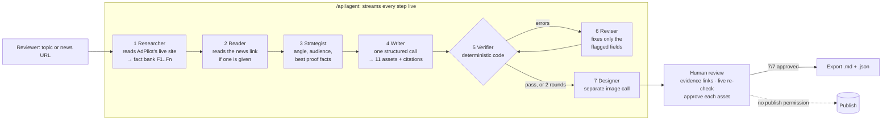

<div align="center">

# ✦ AdPilot — Content Intelligence Agent

**Turn one insight into a campaign.**
An agentic system that researches a client, writes a full multi-channel content pack, **verifies every claim against the source**, fixes its own mistakes, and waits for a human to approve before anything leaves the building.

**Team Gamma · AI FDE Fellowship (Build Fast with AI) · Week 1**

🔗 **Live demo:** **[adpilot-media.vercel.app](https://adpilot-media.vercel.app)**

<br/>


</div>

## 👥 Team Gamma

| | Member | Role | Contribution |
|---|---|---|---|
| **G** | **Greeshma** | Prototype & pipeline | Built the team's first working prototype: the AdPilot fact bank, the single-call generation pipeline, the "every number must exist in the source" validator idea, and the first review UI with per-asset approval. |
| **R** | **Radhika Asati** | Client research & testing | Researched the AdPilot client: services, pricing, client results and brand tone, which became the facts and tone rules the agent follows. Tested topics, found failure cases and checked outputs against the brief. |
| **A** | **Asmita Roy** | Agent & product | Built this version: live research and fact extraction, the planning step, the self-revision loop, model fallback, streaming agent trace, evidence linking, evaluation and tests, and the product UI (channel previews, approval gate, Library and Exports, responsive, light/dark). |

Full details are in [Team Gamma: who did what](#7-team-gamma-who-did-what).

---

## Contents
1. [The client and the problem](#1-the-client-and-the-problem)
2. [What the agent does](#2-what-the-agent-does)
3. [How it works](#3-how-it-works)
4. [Tech stack and models](#4-tech-stack-and-models)
5. [Verification, self-revision and evaluation](#5-verification-self-revision-and-evaluation)
6. [The product](#6-the-product) · [Screenshots](#screenshots)
7. [Team Gamma: who did what](#7-team-gamma-who-did-what)
8. [Run it locally](#8-run-it-locally)
9. [Deploy to Vercel](#9-deploy-to-vercel)
10. [Project structure](#10-project-structure)
11. [Limitations and roadmap](#11-limitations-and-roadmap)

---

## 1. The client and the problem

**AdPilot Media** is a performance-marketing agency in Ahmedabad that runs Meta and Google ads for D2C brands and local businesses. Their brand voice is **proof-led**: they sell with real client results, for example:

- a skincare D2C brand whose **ROAS rose from 2.1 to 3.4 in 90 days**
- a dental clinic chain whose **cost per lead fell from ₹420 to ₹260**
- a coaching centre that went from **1x to 3x monthly enquiries** on the same budget

They need content across six channels every week. The risk with AI-written marketing is **invented statistics**. For an agency, one fake number in an ad can cost a client's trust.

**Our brief:** a working app that takes a topic or a news link, researches AdPilot, and produces a reviewable content pack (blog, LinkedIn, X thread, Instagram, 3 Meta ads, 3 Google ads, an image concept and a generated image), where a person reviews every draft and **nothing is auto-published**.

## 2. What the agent does

One topic in, one verified content pack out:

| Asset | Rules enforced |
|---|---|
| Blog post | 300–400 words, subheadings, ends with the free-audit CTA |
| LinkedIn post | 120–180 words |
| X thread | 4–6 posts, each ≤ 280 characters |
| Instagram caption | caption plus 6–12 hashtags |
| Meta ads ×3 | exactly 3: **proof-led**, **offer-led**, **pain-led** |
| Google search ads ×3 | 3–5 headlines ≤ 30 chars, exactly 2 descriptions ≤ 90 chars |
| Image | concept, prompt and a generated image (separate model call) |

Every asset lists the **fact IDs** (F1, F2, …) that support its claims.

## 3. How it works



| Step | Agent | What happens |
|---|---|---|
| 1 | **Researcher** | Fetches the AdPilot site and uses the LLM to extract a fact bank, with every number copied exactly. If the site is unreachable it falls back to a saved snapshot, and the UI shows which source was used. |
| 2 | **Reader** | If the input is a URL, it reads the article and pulls out takeaways. |
| 3 | **Strategist** | Picks the angle, the audience, a key message and the 3–6 facts that prove it best. |
| 4 | **Writer** | Writes all 11 assets in **one structured call** (Zod schema), so the message stays consistent across channels. |
| 5 | **Verifier** | Plain TypeScript, **no LLM**. It checks numbers against the sources, character limits, ad counts, citations and hype words. |
| 6 | **Reviser** | Sends the exact failed checks back to the model and asks it to change **only those fields**. Up to 2 rounds; anything still failing is escalated to the human. |
| 7 | **Designer** | Generates the image in a separate call: the Gemini image model, then OpenAI, then free FLUX. If all fail, the image prompt is kept for review. |

## 4. Tech stack and models

| Layer | Choice |
|---|---|
| App | **Next.js 16** (App Router), **TypeScript**, React 19 |
| AI SDK | **Vercel AI SDK v7** (`generateText` + `Output.object`) with **Zod** schemas, so the model returns typed JSON |
| Text model | **Gemini 3.8 Flash**, falling back through Gemini 3.7, 3.6 and 3.5 Flash, 3.5 Flash-Lite and 3 Flash. Each model has its own free-tier quota, and a quota error moves straight to the next model |
| Image model | **Gemini 3.1 Flash Image** (paid tier) → OpenAI `gpt-image-1` (if `OPENAI_API_KEY` is set) → **FLUX via Pollinations** (free, no key). `IMAGE_PROVIDER=free` uses the free provider directly |
| Providers | Gemini API (AI Studio key), with Vertex AI express mode as a fallback |
| Streaming | NDJSON event stream: the UI renders each agent step live |
| Storage | None on the server. Runs, approvals and exports live in browser localStorage |
| Tests | `node:test` + `tsx` (verifier unit tests) |
| UI | Hand-written CSS with design tokens, light/dark themes, lucide icons, Fontsource fonts |
| Hosting | Vercel |

**Why no vector database or RAG?** The source is one small website with about a dozen facts. It all fits in the prompt, so retrieval infrastructure would add complexity for no gain.

## 5. Verification, self-revision and evaluation

### Verifier checks (`lib/validate.ts`)
| Check | Severity |
|---|---|
| Every number in every asset exists on AdPilot's site or in the source article | error |
| X: 4–6 posts, each ≤ 280 chars | error |
| Google: exactly 3 ads; 3–5 headlines ≤ 30 chars; exactly 2 descriptions ≤ 90 chars | error |
| Meta: exactly 3 ads | error |
| Cited fact IDs must exist | error |
| Hype or guarantee language ("guaranteed", "skyrocket", "10x", …) | error |
| Meta angles distinct, headline ≤ 40; blog/LinkedIn length; hashtag count; image prompt says "no text" | warning |

**Why code and not another LLM?** An LLM grading an LLM can share its blind spots. A number either exists in the source or it doesn't.

### A real failure the agent caught and fixed
In a live run, the first draft had a Google ad description of **92 characters** (the limit is 90). The verifier flagged it, the Reviser rewrote **only that field**, and the pack passed with all 58 numbers traced to the source. The UI's **Draft ↔ Revised** toggle shows exactly this.

### Evaluation (`/api/eval`)
Five fixed topics run through the full agent (without the image). It reports:
- **First-pass rate:** drafts with zero errors
- **Pass rate after self-revision**
- **Errors caught** and **errors fixed by the agent**

Live results are saved to `data/eval-results.json`.

### Unit tests
```bash
npm test   # 7 tests: number extraction, planted failures, limits, counts, citations, hype words
```

## 6. The product

- **Workflow panel:** a live execution trace showing which agent is running, its task, a timer and its status.
- **Content studio:** realistic previews for each channel (blog article, LinkedIn post, X thread, Instagram post, Facebook feed ads, Google search ads), plus **Edit** mode with character counters.
- **Evidence-backed:** every number in the content is highlighted. Click it to jump to the source fact. Green means sourced; red means unsupported.
- **Self-correction visible:** Draft vs Revised, gold "revised" markers, and a revision log of what failed and what was fixed.
- **Human approval gate:** each asset must be approved, and **Export stays locked until 7/7**. The agent has no publish capability at all.
- **Library and Exports:** past runs and exported packs are saved in the browser.
- **Demo mode:** a recorded run (clearly labelled) for offline presentations.
- **Responsive:** fits on one screen on laptops (panels scroll inside), and stacks with a bottom nav on phones.
- **Light and dark themes** with a smooth 350 ms transition. The choice is remembered, and it's applied before first paint so there's no flash.
- **Self-hosted fonts** (Newsreader, Inter, JetBrains Mono, Caveat via Fontsource): no external font requests, so the UI looks the same offline.

### Screenshots

| Light | Dark |
|---|---|
|  |  |
|  |  |

**Evidence linking:** clicking a number (here "1x") opens the Factual verification card and highlights the fact it came from (F6).


**Self-correction:** the first draft, where the verifier caught a 36-character Google headline (max 30) and two invented statistics. Switch to *Revised* to see the fix.


**Channel previews:** three Meta ads, one per angle (proof-led, offer-led, pain-led), rendered as Facebook feed ads.


**On a phone**

| Landing | Workspace (light) | Workspace (dark) |
|---|---|---|
|  |  |  |

<sub>Screenshots show DEMO mode (the recorded run), which is why the image is a placeholder graphic. In LIVE mode the image is generated by the image model.</sub>

## 7. Team Gamma: who did what

Each member built and owns a part of the AdPilot agent; this repository combines the team's work.

| Member | Role | Tasks |
|---|---|---|
| **Greeshma** | Prototype & pipeline | Built the team's first working prototype ([AGSGreeshma/Adpilot_content_agent](https://github.com/AGSGreeshma/Adpilot_content_agent)): the curated AdPilot fact bank, the single-call generation pipeline with a Zod schema, the deterministic "every number must exist in the fact bank" validator idea, and the first editable review UI with per-asset approval. This version builds on that design. |
| **Radhika Asati** | Client research & testing | Studied the AdPilot client site: services, pricing, client results and brand tone, which became the facts and tone rules the agent is held to. Tested the agent across topics, found failure cases and checked outputs against the brief, which feeds the evaluation set. |
| **Asmita Roy** | Agent & product | Built this Research & Revise version: live site research with LLM fact extraction and snapshot fallback, news-link input, the Strategist step, the self-revision loop, the Gemini model and provider fallback chain, streaming agent trace, evidence linking, the evaluation harness and verifier unit tests, the product UI (channel previews, approval gate, Library and Exports, responsive, dark mode), and the docs. |

## 8. Run it locally

Requires **Node 20+**.

```bash
git clone https://github.com/techAsmita/AdPilot-Media.git
cd AdPilot-Media
npm install
cp .env.example .env.local     # then paste your Gemini API key
npm run dev                    # http://localhost:3000
```

### Environment variables
| Variable | Required | Purpose |
|---|---|---|
| `GEMINI_API_KEY` | yes (for LIVE) | Gemini API key from Google AI Studio |
| `GEMINI_PROVIDER` | recommended | `gemini` to use the Gemini API directly (skips Vertex) |
| `TEXT_MODEL` | no | Override the text model order, comma-separated |
| `IMAGE_MODEL` | no | Override the Gemini image model order, comma-separated |
| `IMAGE_PROVIDER` | no | `free` = skip paid image models and use FLUX via Pollinations (no key needed) |
| `OPENAI_API_KEY` | no | Enables OpenAI `gpt-image-1` as an image provider |

Without a key, the app runs in **DEMO** mode automatically. `.env.local` is git-ignored, so never commit keys.

## 9. Deploy to Vercel

1. Go to [vercel.com/new](https://vercel.com/new) and import `techAsmita/AdPilot-Media`. The framework is detected as Next.js automatically.
2. Under **Environment Variables**, add `GEMINI_API_KEY`, `GEMINI_PROVIDER=gemini` and `IMAGE_PROVIDER=free` (remove the last one once paid image credits are set up).
3. Click **Deploy**. Live at **https://adpilot-media.vercel.app**. Every push to `main` redeploys automatically.

Note: a full live run takes about a minute. The routes set `maxDuration = 300`, which fits Vercel's free Hobby plan. Run the 5-topic **Eval** locally and commit `data/eval-results.json`; the deployed app shows those saved results (Vercel's filesystem is read-only, so eval runs there are not saved).

## 10. Project structure

```
app/
  page.tsx                  app shell: header, hero, run state, routing
  icon.svg                  favicon
  components/
    Workflow.tsx            live agent trace
    Studio.tsx              tabs, preview/edit, draft vs revised, approve
    previews.tsx            channel previews + evidence highlighting
    Quality.tsx             factual verification, compliance, revision log, approval gate
    EvalModal.tsx           evaluation runner
    Library.tsx             saved runs and exports
  api/
    agent/route.ts          the agent (streaming)
    image/route.ts          regenerate image
    eval/route.ts           5-topic evaluation
    status/route.ts         key check + research warm-up
lib/
  agent.ts                  orchestration: research → plan → write → verify → revise → image
  sources.ts                site and news fetching, snapshot fallback
  prompts.ts                system and step prompts
  schema.ts                 Zod schemas, limits
  validate.ts               deterministic verifier
  llm.ts                    Gemini / Vertex provider and model fallback
  mock.ts                   recorded demo run
  client.ts                 streaming, evidence linking, browser storage
tests/validate.test.ts      verifier unit tests
docs/ARCHITECTURE.md        design decisions
docs/screenshots/           README images
```

## 11. Limitations and roadmap

**Limitations**
- Facts come from a single client page. The number check proves a number **exists** in the source, not that it is used in the right **context** (for example, "3.4" attached to the wrong client).
- Tone is guided by the prompt but not scored.
- Runs and approvals live in the browser, not a shared database.
- A full live run takes about 1 minute. On the free tier, daily quotas can run out after heavy testing; the app then shows a clear message, and DEMO mode still works.

**Roadmap**
- [ ] Context-aware claim check (number + client + metric must match one fact)
- [ ] LLM judge for tone ("proof-led, no hype") on top of the code checks
- [ ] Multi-page crawl plus a client brief upload
- [ ] Shared workspace with a database and reviewer roles
- [ ] Parallel generation per channel to cut latency
- [ ] Scheduled content calendar (drafts only; publishing stays human)

---

<div align="center">
<sub>Built by Team Gamma: Greeshma, Radhika Asati and Asmita Roy · AI FDE Fellowship by Build Fast with AI · AdPilot Media is a fictional client created for the fellowship.</sub>
</div>
