<div align="center">

# ✦ AdPilot — Content Intelligence Agent

**Turn one insight into a campaign.**
An agentic system that researches a client, writes a full multi-channel content pack, **verifies every claim against the source**, fixes its own mistakes, and waits for a human to approve before anything leaves the building.

**Team Gamma · AI FDE Fellowship (Build Fast with AI) · Week 1**

🔗 **Live demo:** **[adpilot-media.vercel.app](https://adpilot-media.vercel.app)**

[](https://github.com/techAsmita/AdPilot-Media/actions/workflows/ci.yml)

<br/>

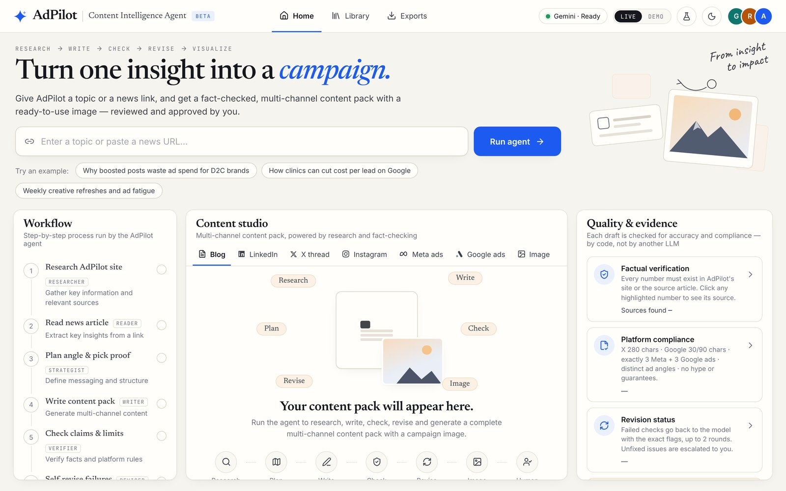

</div>

## 👥 Team Gamma

| | Member | Role | Contribution |
|---|---|---|---|
| **G** | **Greeshma** | Prototype, pipeline & hardening | Built the team's first working prototype (fact bank, single-call pipeline, the "every number must exist in the source" validator idea, first review UI). Then led the production hardening pass: the OpenAI provider, outbound-URL (SSRF) guard, rate limits and daily budget, a stricter verifier with field-level repair, Stop/Rewrite controls, accessibility, security headers, CI, and most of the test suite. |
| **R** | **Radhika Asati** | Client research & testing | Researched the AdPilot client: services, pricing, client results and brand tone, which became the facts and tone rules the agent follows. Tested topics, found failure cases and checked outputs against the brief. |
| **A** | **Asmita Roy** | Agent & product | Built this version: live research and fact extraction, the planning step, the self-revision loop, model fallback, streaming agent trace, evidence linking, evaluation and tests, and the product UI (channel previews, approval gate, Library and Exports, responsive, light/dark). |

Full details are in [Team Gamma: who did what](#7-team-gamma-who-did-what).

---

## Contents
1. [The client and the problem](#1-the-client-and-the-problem)
2. [What the agent does](#2-what-the-agent-does)
3. [How it works](#3-how-it-works)
4. [Tech stack and models](#4-tech-stack-and-models)
5. [Verification, self-revision and evaluation](#5-verification-self-revision-and-evaluation)
6. [The product](#6-the-product) · [Screenshots](#screenshots)
7. [Team Gamma: who did what](#7-team-gamma-who-did-what)
8. [Run it locally](#8-run-it-locally)
9. [Deploy to Vercel](#9-deploy-to-vercel)
10. [Security and cost controls](#10-security-and-cost-controls)
11. [Project structure](#11-project-structure)
12. [Limitations and roadmap](#12-limitations-and-roadmap)

---

## 1. The client and the problem

**AdPilot Media** is a performance-marketing agency in Ahmedabad that runs Meta and Google ads for D2C brands and local businesses. Their brand voice is **proof-led**: they sell with real client results, for example:

- a skincare D2C brand whose **ROAS rose from 2.1 to 3.4 in 90 days**
- a dental clinic chain whose **cost per lead fell from ₹420 to ₹260**
- a coaching centre that went from **1x to 3x monthly enquiries** on the same budget

They need content across six channels every week. The risk with AI-written marketing is **invented statistics**. For an agency, one fake number in an ad can cost a client's trust.

**Our brief:** a working app that takes a topic or a news link, researches AdPilot, and produces a reviewable content pack (blog, LinkedIn, X thread, Instagram, 3 Meta ads, 3 Google ads, an image concept and a generated image), where a person reviews every draft and **nothing is auto-published**.

## 2. What the agent does

One topic in, one verified content pack out:

| Asset | Rules enforced |
|---|---|
| Blog post | 300–400 words, subheadings, ends with the free-audit CTA |
| LinkedIn post | 120–180 words |
| X thread | 4–6 posts, each ≤ 280 characters |
| Instagram caption | caption plus 6–12 hashtags |
| Meta ads ×3 | exactly 3: **proof-led**, **offer-led**, **pain-led** |
| Google search ads ×3 | 3–5 headlines ≤ 30 chars, exactly 2 descriptions ≤ 90 chars |
| Image | concept, prompt and a generated image (separate model call) |

Every asset lists the **fact IDs** (F1, F2, …) that support its claims.

## 3. How it works

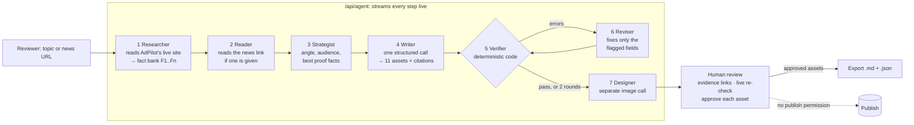

| Step | Agent | What happens |
|---|---|---|
| 1 | **Researcher** | Fetches the AdPilot site and uses the LLM to extract a fact bank, with every number copied exactly. If the site is unreachable it falls back to a saved snapshot, and the UI shows which source was used. |
| 2 | **Reader** | If the input is a URL, it reads the article and pulls out takeaways. |
| 3 | **Strategist** | Picks the angle, the audience, a key message and the 3–6 facts that prove it best. |
| 4 | **Writer** | Writes all 11 assets in **one structured call** (Zod schema), so the message stays consistent across channels. |
| 5 | **Verifier** | Plain TypeScript, **no LLM**. It checks numbers against the sources, character limits, ad counts, citations and hype words. |
| 6 | **Reviser** | Sends the failed checks back to the model. When every failure is a single field, it sends **only those fields** and receives only replacements, so the ten assets nobody complained about never leave the server and cannot be disturbed. A structural failure (wrong number of ads) falls back to a whole-pack rewrite. Up to 2 rounds; anything still failing is escalated to the human. |
| 7 | **Designer** | Generates the image in a separate call: OpenAI, or the Gemini image model, then free FLUX as a last resort. If all fail, the image prompt is kept for review. |

## 4. Tech stack and models

| Layer | Choice |
|---|---|
| App | **Next.js 16** (App Router), **TypeScript**, React 19 |
| AI SDK | **Vercel AI SDK v7** (`generateText` + `Output.object`) with **Zod** schemas, so the model returns typed JSON |
| Text model | **OpenAI `gpt-4.1-mini`**, with `gpt-4.1-nano` behind it. Google (Gemini API, then Vertex AI express mode) is supported as an alternative provider. Set `TEXT_PROVIDER` to pin one |
| Image model | **OpenAI `gpt-image-2.5-flare`** → Gemini image models (if a Google key is set) → **FLUX via Pollinations** (free, no key). `IMAGE_PROVIDER` pins `openai`, `gemini` or `free` |
| Fallback | One deadline covers the whole chain (`MODEL_DEADLINE_MS`, default 120 s) with a per-attempt cap, and a transient 5xx retries the same model once before dropping to a weaker one |
| Streaming | NDJSON event stream, typed end to end by one `AgentEvent` union: the UI renders each agent step live |
| Storage | None on the server. Runs, approvals and exports live in browser localStorage |
| Tests | `node:test` + `tsx` — **96 tests** across the verifier, URL guard, tokenizer, rate limiter, stream reducer, NDJSON framing and accessibility contracts |
| CI | GitHub Actions: typecheck → lint (ESLint 9) → test → build, including a build with no API key |
| UI | Hand-written CSS with design tokens, light/dark themes, lucide icons, fonts self-hosted via `next/font` |
| Hosting | Vercel. `maxDuration = 300` is the **maximum on Hobby with Fluid compute** (default for new projects) and the default on Pro. Without Fluid, Hobby caps at 60 s |

### What this deployment runs on, and what it costs

| Part | Provider / model | Cost |
|---|---|---|
| Text (research, plan, writing, revision) | OpenAI **`gpt-4.1-mini`** — $0.40 / 1M input, $1.60 / 1M output | **≈ $0.016 per run** (~10k in, ~7.5k out across four calls) |
| Image | OpenAI **`gpt-image-2.5-flare`**, `quality=low`, 1024×1024 | **≈ $0.03–0.05 per image** (token-priced; confirm against your dashboard) |
| Image (free alternative) | **FLUX** via **Pollinations**, `IMAGE_PROVIDER=free` | ₹0, no key (anonymous tier: ~1 image per 15 s, may watermark) |
| Text (free alternative) | Google **Gemini** Flash on the AI Studio free tier | ₹0, with daily per-model limits |
| Verifier, revision loop, UI | Our code | ₹0 |
| Hosting | **Vercel** | Free on Hobby, including the 300 s function duration with Fluid compute |
| Repository | GitHub | ₹0 |

**≈ $0.05 per full run**, and the image is the larger half — so `IMAGE_PROVIDER=free` roughly halves it. Costs are measured, not estimated, except the per-image figure, which is derived from the published token rates because OpenAI does not publish a per-image table for this model.

Two cost controls are built in rather than left to discipline: the revise step sends only the broken fields (a **66% smaller** prompt than resending the pack), and `DAILY_RUN_BUDGET` caps billable runs per day.

**Why no vector database or RAG?** The source is one small website with about a dozen facts. It all fits in the prompt, so retrieval infrastructure would add complexity for no gain.

## 5. Verification, self-revision and evaluation

### Verifier checks (`lib/validate.ts`)
| Check | Severity |
|---|---|
| Every number in every asset exists on AdPilot's site or in the source article | error |
| **A number is used with the unit the source gives it** — `3.4` is real, `3.4%` is not | error |
| X: 4–6 posts, each ≤ 280 chars | error |
| Google: exactly 3 ads; 3–5 headlines ≤ 30 chars; exactly 2 descriptions ≤ 90 chars | error |
| Meta: exactly 3 ads; **headline ≤ 40, description ≤ 30, primary text < 400** | error |
| Cited fact IDs must exist | error |
| Hype or guarantee language — `guaranteed`, `skyrocket`, `assured`, `#1`, `risk-free`, `instant`, `5x ROAS`, … | error |
| **A number that appears only in the linked article, not on AdPilot's site** — keep it attributed | warning |
| Meta angles distinct; blog/LinkedIn length; hashtag count; **blog ends with the free-audit CTA**; image prompt says "no text" | warning |

Two details worth knowing:

- **The verifier and the UI share one tokenizer** (`lib/numbers.ts`). Previously they used two different regexes, so the highlighting could disagree with the flags about what counted as a number.
- **Site and article evidence are separate tiers.** A linked news article used to whitelist every figure in it, which weakened the check exactly when the model had the most unfamiliar material to work from.

**Why code and not another LLM?** An LLM grading an LLM can share its blind spots. A number either exists in the source or it doesn't.

### A real failure the agent caught and fixed
In a live run, the first draft had a Google ad description of **92 characters** (the limit is 90). The verifier flagged it, the Reviser rewrote **only that field**, and the pack passed with all 58 numbers traced to the source. The UI's **Draft ↔ Revised** toggle shows exactly this.

### Evaluation (`/api/eval`)
Five fixed topics run through the full agent (without the image). It reports:
- **First-pass rate:** drafts with zero errors
- **Pass rate after self-revision**
- **Errors caught** and **errors fixed by the agent**

Live results are written to `data/eval-results.json`, and a sample set is committed so the tiles are populated on a fresh deploy (labelled as sample numbers in the UI). The route also keeps the last result in memory, because most hosts give you a read-only filesystem.

### Tests and checks
```bash
npm test          # 96 tests
npm run typecheck # tsc --noEmit
npm run lint      # ESLint 9
npm run build     # must also pass with no API key
```

| File | Covers |
|---|---|
| `tests/validate.test.ts` | The verifier: units, news tiering, limits, counts, citations, hype, CTA |
| `tests/net.test.ts` | The outbound URL guard — 18 refused hosts, redirect hops, byte cap, content types |
| `tests/numbers.test.ts` | The shared tokenizer |
| `tests/patch.test.ts` | Field-level repair: every flag path resolves, structural paths are refused |
| `tests/run-state.test.ts` | The stream reducer |
| `tests/client.test.ts` | NDJSON framing, evidence linking, markdown export |
| `tests/sources.test.ts` | HTML-to-text extraction and fact ranking |
| `tests/ratelimit.test.ts` | Per-IP windows and the daily budget |
| `tests/a11y.test.tsx` | Accessibility contracts, asserted against rendered markup |

The demo draft's intentional defects are declared in `PLANTED_DEFECTS` (`lib/mock.ts`) and the tests assert against that list, so editing the demo copy means editing the list rather than hunting a mystery assertion.

## 6. The product

- **Workflow panel:** a live execution trace showing which agent is running, its task, a timer and its status.
- **Content studio:** realistic previews for each channel (blog article, LinkedIn post, X thread, Instagram post, Facebook feed ads, Google search ads), plus **Edit** mode with character counters.
- **Evidence-backed:** every number in the content is highlighted. Click or tab to it to jump to the source fact. Green means sourced; red means unsupported.
- **Self-correction visible:** Draft vs Revised, gold "revised" markers, and a revision log of what failed and what was fixed.
- **Human approval gate:** each asset must be approved, the agent has no publish capability at all, and the gate is enforced rather than advisory — **an asset with open errors cannot be approved, and editing an asset withdraws its approval.** Export records how many of the seven were signed off.
- **Stop:** a run can be cancelled mid-flight. The server honours the disconnect, so a closed tab stops costing tokens too.
- **Rewrite one channel:** if only the LinkedIn post is weak, rewrite just that asset instead of rerunning all eleven. The other ten are returned byte-identical.
- **Library and Exports:** past runs and exported packs are saved in the browser.
- **Demo mode:** a recorded run (clearly labelled) for offline presentations.
- **Responsive:** fits on one screen on laptops (panels scroll inside), and stacks with a bottom nav on phones.
- **Light and dark themes** with a smooth 350 ms transition. The choice is remembered across visits and applied before first paint, so there is no flash.
- **Keyboard and screen-reader support:** evidence links are real buttons, the channel tabs implement the full tab pattern (arrow keys, `aria-controls`), the evaluation dialog traps focus and closes on Escape, and no status is conveyed by colour alone.
- **Self-hosted fonts** (Newsreader, Inter, JetBrains Mono, Caveat via `next/font`): subsetted at build time, with no request to a font CDN.

### Screenshots

| Light | Dark |
|---|---|
| 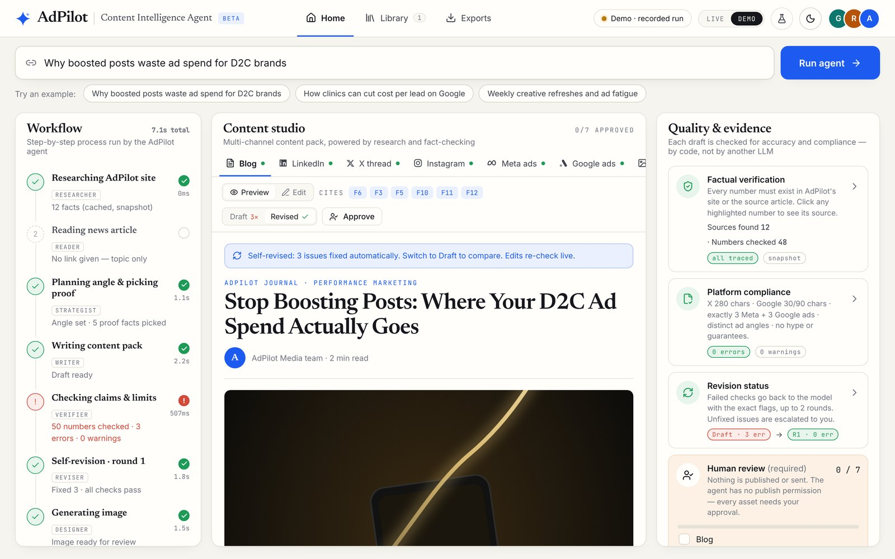 | 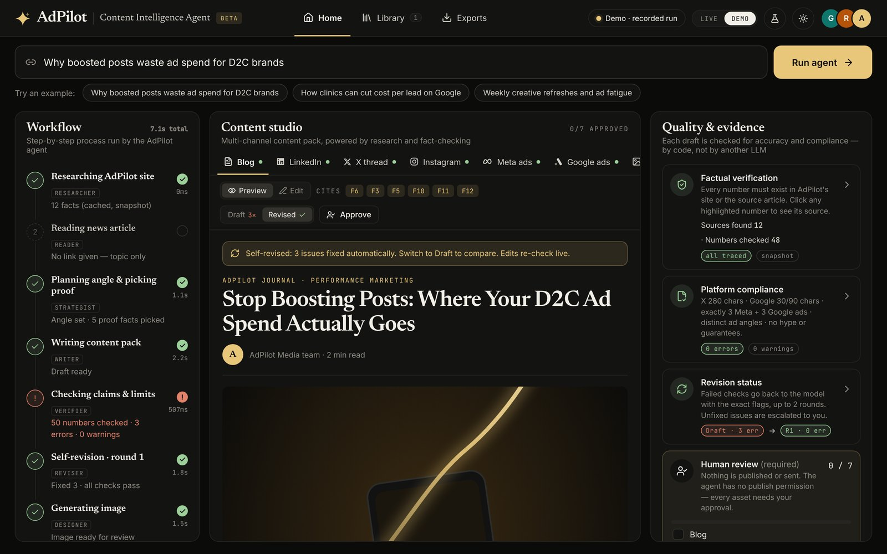 |
|  | 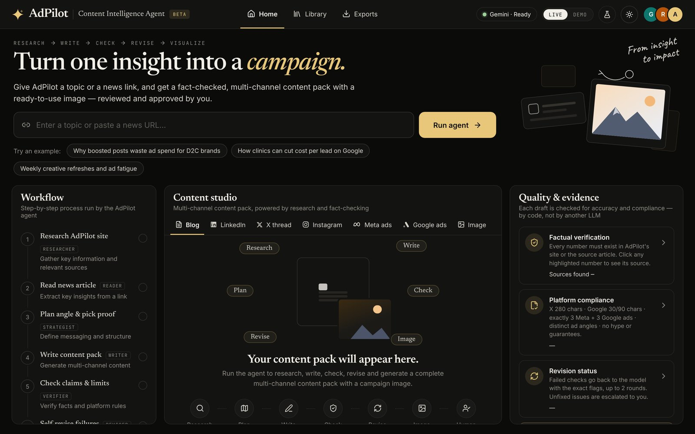 |

**Evidence linking:** clicking a number (here "1x") opens the Factual verification card and highlights the fact it came from (F6).
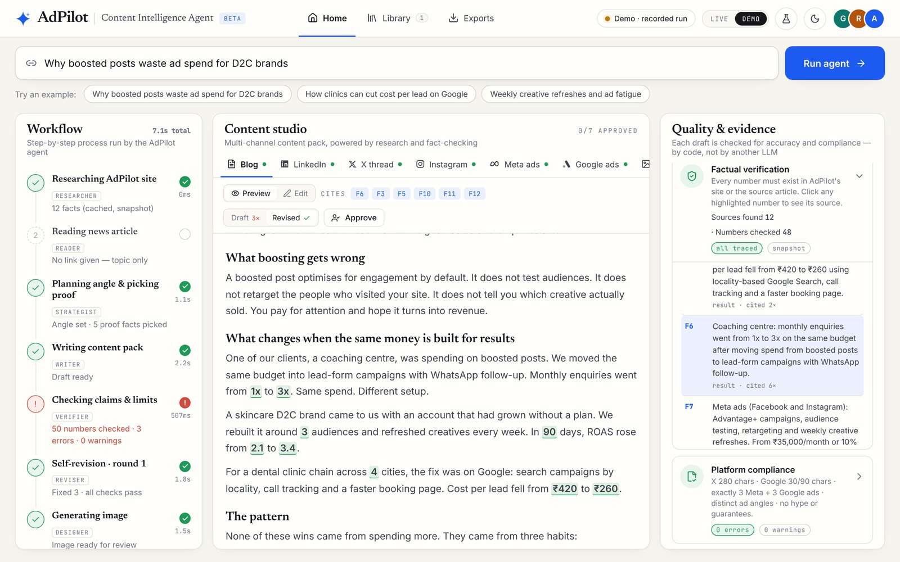

**Self-correction:** the first draft, where the verifier caught a 36-character Google headline (max 30) and two invented statistics. Switch to *Revised* to see the fix.
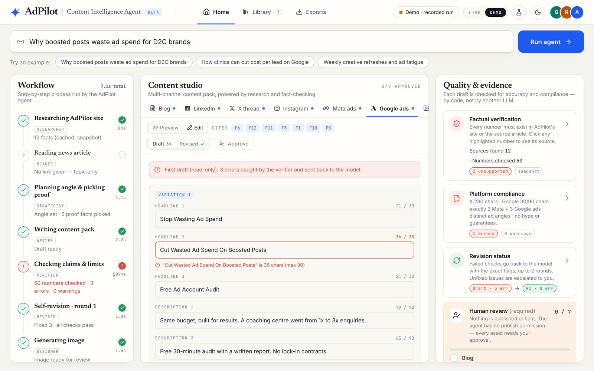

**Channel previews:** three Meta ads, one per angle (proof-led, offer-led, pain-led), rendered as Facebook feed ads.
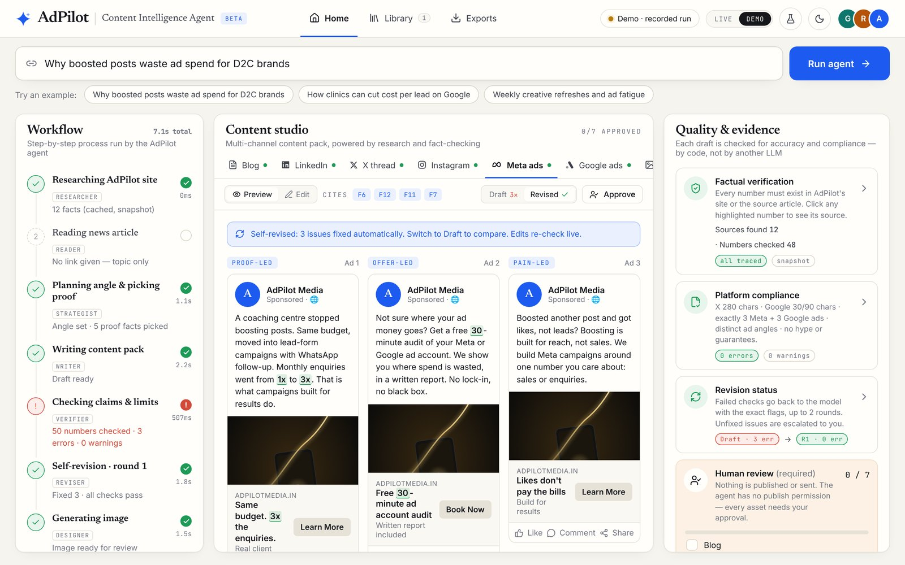

**On a phone**

| Landing | Workspace (light) | Workspace (dark) |
|---|---|---|
| 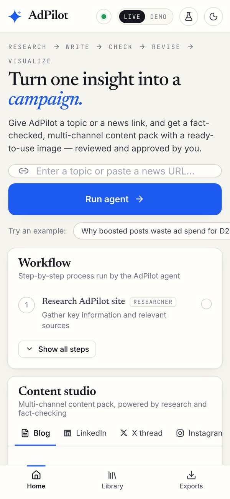 | 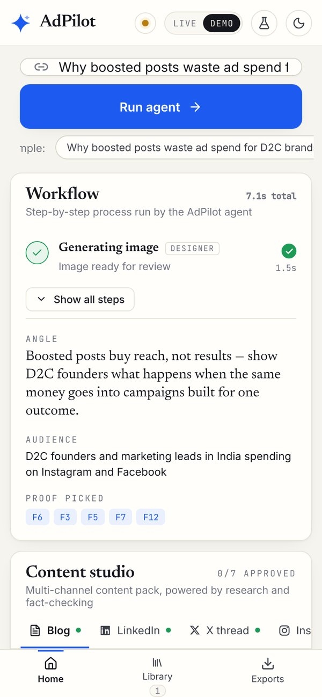 | 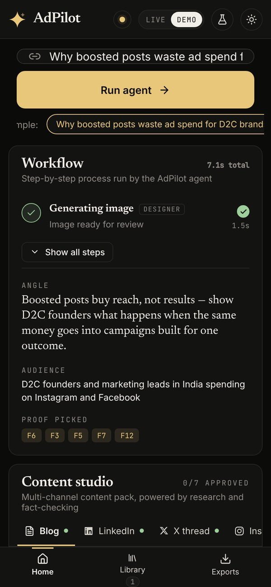 |

<sub>Screenshots show DEMO mode (the recorded run), which is why the image is a placeholder graphic. In LIVE mode the image comes from OpenAI <code>gpt-image-2.5-flare</code>, or from FLUX via Pollinations when <code>IMAGE_PROVIDER=free</code>.</sub>

## 7. Team Gamma: who did what

Each member built and owns a part of the AdPilot agent; this repository combines the team's work.

| Member | Role | Tasks |
|---|---|---|
| **Greeshma** | Prototype, pipeline & hardening | Built the team's first working prototype ([AGSGreeshma/Adpilot_content_agent](https://github.com/AGSGreeshma/Adpilot_content_agent)): the curated AdPilot fact bank, the single-call generation pipeline with a Zod schema, the deterministic "every number must exist in the fact bank" validator idea, and the first editable review UI with per-asset approval. This version builds on that design. She then led the production hardening pass: the OpenAI text and image provider, the outbound-URL (SSRF) guard, per-IP rate limits and a daily run budget, a stricter verifier with field-level repair and a cheaper revise loop, Stop/Rewrite/reset controls, accessibility and security headers, the CI workflow, and most of the 96-test suite. |
| **Radhika Asati** | Client research & testing | Studied the AdPilot client site: services, pricing, client results and brand tone, which became the facts and tone rules the agent is held to. Tested the agent across topics, found failure cases and checked outputs against the brief, which feeds the evaluation set. |
| **Asmita Roy** | Agent & product | Built this Research & Revise version: live site research with LLM fact extraction and snapshot fallback, news-link input, the Strategist step, the self-revision loop, the multi-model and multi-provider fallback chain, streaming agent trace, evidence linking, the evaluation harness and verifier unit tests, the product UI (channel previews, approval gate, Library and Exports, responsive, dark mode), and the docs. |

## 8. Run it locally

Requires **Node 20+**.

```bash
git clone https://github.com/techAsmita/AdPilot-Media.git
cd AdPilot-Media
npm install
cp .env.example .env.local     # then paste your OpenAI (or Gemini) API key
npm run dev                    # http://localhost:3000
```

### Environment variables

At least one text key is required for LIVE mode. Without any key the app runs in **DEMO** mode automatically. `.env` and `.env.local` are both git-ignored, so never commit keys.

**Text**
| Variable | Required | Purpose |
|---|---|---|
| `OPENAI_API_KEY` | one of these | OpenAI API key |
| `GEMINI_API_KEY` | one of these | Google AI Studio key (an `AQ.` key routes through Vertex express mode) |
| `OPENAI_TEXT_MODEL` | no | Model order, comma-separated. Default `gpt-4.1-mini,gpt-4.1-nano` |
| `TEXT_MODEL` | no | Gemini model order, comma-separated |
| `TEXT_PROVIDER` | no | Pin `openai`, `gemini` or `vertex`. Unset = OpenAI first when both keys exist |
| `MODEL_DEADLINE_MS` | no | Deadline for the whole fallback chain. Default `120000`; keep it below `maxDuration` |
| `MODEL_ATTEMPT_MS` | no | Per-attempt cap. Default `60000` |

**Image**
| Variable | Required | Purpose |
|---|---|---|
| `IMAGE_PROVIDER` | no | Pin `openai`, `gemini` or `free`. Unset = try each whose key exists, then free |
| `OPENAI_IMAGE_MODEL` | no | Default `gpt-image-2.5-flare`. **`gpt-image-1` was shut down on 2026-10-23** |
| `OPENAI_IMAGE_QUALITY` | no | `low` \| `medium` \| `high` (flare also takes `xhigh` \| `max`) |
| `OPENAI_IMAGE_SIZE` | no | Pins one size for every channel. Unset follows the pack's aspect ratio |
| `OPENAI_IMAGE_FORMAT` | no | `jpeg` (default) \| `png` \| `webp`. See the note below |
| `IMAGE_MODEL` | no | Gemini image model order, comma-separated |

**Deployment**
| Variable | Required | Purpose |
|---|---|---|
| `CLIENT_URL` | recommended | The client site to research. The built-in fallback is a third-party demo domain, and leaving it unset is announced in the log |
| `DAILY_RUN_BUDGET` | no | Billable runs per day, per server instance. Default `200`; `0` disables |
| `NEXT_PUBLIC_SITE_URL` | for sharing | Public origin for the OpenGraph image. **Must be set at build time** — the page is prerendered, so the URL is baked in by `next build` |

> **Why `jpeg` is the default image format.** The generated image travels as a base64 data URL through the event stream, React state and `localStorage`, and saved runs drop images over ~900 KB. Measured at 1024×1024 / `low`: **jpeg ≈ 127 KB, webp ≈ 1.1 MB, png ≈ 1.8 MB.** On png, some runs lose their Library thumbnail.

## 9. Deploy to Vercel

1. Go to [vercel.com/new](https://vercel.com/new) and import `techAsmita/AdPilot-Media`. The framework is detected as Next.js automatically.
2. Under **Environment Variables**, add `OPENAI_API_KEY`, `CLIENT_URL`, and `NEXT_PUBLIC_SITE_URL=https://your-domain`. Add `IMAGE_PROVIDER=free` if you would rather not pay for images.
3. Click **Deploy**. Live at **https://adpilot-media.vercel.app**. Every push to `main` redeploys automatically.

**`maxDuration` and your plan.** A full live run takes about 25–60 s (measured ≈25 s on `gpt-4.1-mini`), and the routes set `maxDuration = 300`.

| Plan | Default | Maximum |
|---|---|---|
| Hobby (Fluid compute) | 300 s | **300 s** |
| Pro (Fluid compute) | 300 s | 800 s, 1800 s extended (beta) |
| Hobby without Fluid | 10 s | 60 s |

**Fluid compute is enabled by default for new projects**, so `maxDuration = 300` works on the free plan. Older projects may predate that default — check the project's compute setting before assuming a long run will survive. If you cannot enable Fluid, lower `MODEL_DEADLINE_MS` so the agent gives up before the platform kills it mid-stream.

**Eval results.** Run the 5-topic **Eval** locally and commit `data/eval-results.json`; the deployed app shows those saved results, because most hosts give you a read-only filesystem.

**Access control.** There is deliberately no in-app login: a token shipped to a browser protects nothing. If the deployment should not be public, put Vercel password protection or SSO in front of it. The rate limits below bound abuse but do not replace that.

## 10. Security and cost controls

This is a public URL that spends money on every request, so a few things are enforced in code rather than left to good behaviour.

| Concern | What is in place |
|---|---|
| **SSRF** | The news link is user-supplied and fetched server-side. `lib/net.ts` refuses non-public hosts (loopback, RFC1918, CGNAT, link-local including `169.254.169.254`, IPv6 ULA/link-local, IPv4-mapped forms, integer-form addresses), rejects non-`http(s)` schemes, embedded credentials and non-web ports, **re-checks every redirect hop**, restricts content types, and reads the body under a 2 MB cap |
| **Abuse / runaway cost** | Per-IP sliding windows (agent 5/min, image 10/min, eval 1/15 min) plus `DAILY_RUN_BUDGET`. Refusals return `429` with `Retry-After` |
| **Wasted spend** | `req.signal` is threaded through to the model calls, so a closed tab or the Stop button actually stops the run |
| **Approval bypass** | An asset with open errors cannot be approved, and editing one withdraws its approval — closing an approve-then-edit-in-a-fake-number path |
| **Headers** | CSP, `nosniff`, `X-Frame-Options: DENY`, `Referrer-Policy`, `Permissions-Policy`, COOP; `x-powered-by` removed |
| **Traceability** | `lib/log.ts` gives every server line a request id, so the four model calls, the image call and any provider failure from one run read together |

Three limits worth being explicit about:

- **Rate-limit counters are in-process.** On serverless, each instance keeps its own, so the real limit is `limit × live instances`. Enough to stop casual abuse; a shared store (Redis/Upstash) is the next step.
- **`script-src` still needs `'unsafe-inline'`** for the pre-paint theme script and Next's own bootstrap. The policy still blocks third-party script origins; a middleware-issued nonce would tighten it.
- **DNS rebinding remains possible.** The guard resolves the host, then `fetch` resolves it again, so a hostile DNS server with a zero TTL could return different answers. Closing it means pinning the resolved IP and carrying the `Host` header plus TLS SNI.

## 11. Project structure

```
app/
  page.tsx                  app shell: header, hero, run state, routing
  icon.svg                  favicon
  components/
    Workflow.tsx            live agent trace
    Studio.tsx              tabs, preview/edit, draft vs revised, approve
    previews.tsx            channel previews + evidence highlighting
    Quality.tsx             factual verification, compliance, revision log, approval gate
    EvalModal.tsx           evaluation runner
    Library.tsx             saved runs and exports
  api/
    agent/route.ts          the agent (streaming)
    asset/route.ts          regenerate one channel
    image/route.ts          regenerate image
    eval/route.ts           5-topic evaluation
    status/route.ts         key check
lib/
  agent.ts                  orchestration; demo vs live sits behind a Brain interface
  image.ts                  image generation and its provider fallback
  sources.ts                site and news fetching, snapshot fallback
  net.ts                    hardened outbound fetch: host guard, redirect re-check, byte cap
  ratelimit.ts              per-IP windows and the daily run budget
  log.ts                    request-scoped logging
  prompts.ts                system and step prompts (fact bank leads, for prefix caching)
  schema.ts                 Zod schemas, limits
  validate.ts               deterministic verifier
  numbers.ts                the number tokenizer shared by verifier and UI
  patch.ts                  field-level repair addressed by flag path
  llm.ts                    provider and model fallback, chain deadline, transient retry
  events.ts                 the AgentEvent wire format and step ids
  run-state.ts              the stream reducer (pure, unit tested)
  text.ts                   word count shared by verifier and editor
  mock.ts                   recorded demo run + PLANTED_DEFECTS
  client.ts                 streaming, evidence linking, browser storage
tests/                      96 tests (see §5)
.github/workflows/ci.yml    typecheck → lint → test → build
docs/ARCHITECTURE.md        design decisions
docs/screenshots/           README images
public/og.jpg               share-card image
data/eval-results.json      committed sample eval results
```

## 12. Limitations and roadmap

**Limitations**
- Facts come from a single client page. The number check now enforces the **unit** a figure is used with, but still not its **context** — "3.4" attached to the wrong client would pass.
- Tone is guided by the prompt but not scored.
- Runs and approvals live in the browser, not a shared database. Images are held as base64 data URLs rather than in a blob store, so they travel through the stream and state as well as storage.
- A full live run takes about 25–60 s, and `gpt-4.1-mini` does not reliably count characters — expect the occasional 31-character Google headline, which is what the two revise rounds are for.
- Prompt-prefix caching is wired up but **not yet paying off**: the shared prefix is ~680 tokens and providers cache above 1024. It starts to help as the fact bank grows.
- Accessibility is verified at the markup level by tests. It has **not** been through a screen-reader or keyboard pass with real assistive technology.

**Roadmap**
- [ ] Context-aware claim check (number + client + metric must match one fact)
- [ ] LLM judge for tone ("proof-led, no hype") on top of the code checks
- [ ] Blob storage for generated images, so they are served by URL instead of inlined
- [ ] Shared rate-limit store, and a CSP nonce in place of `'unsafe-inline'`
- [ ] Multi-page crawl plus a client brief upload
- [ ] Shared workspace with a database and reviewer roles
- [ ] Parallel generation per channel to cut latency
- [ ] Scheduled content calendar (drafts only; publishing stays human)

---

<div align="center">
<sub>Built by Team Gamma: Greeshma, Radhika Asati and Asmita Roy · AI FDE Fellowship by Build Fast with AI · AdPilot Media is a fictional client created for the fellowship.</sub>
</div>
