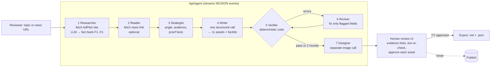

# Architecture — AdPilot Content Intelligence Agent

A single Next.js app. The browser streams the agent's progress from one API route; each step is a separate, inspectable stage. No database, no vector store — the client's source material is one small site.

## Design decisions

| Decision | Why |
|---|---|
| **Verifier is code, not an LLM** | An LLM grading an LLM can share its blind spots. A number either exists in the source or it doesn't. |
| **Every asset cites fact IDs** | Claims are traceable; the UI links each number back to its fact. |
| **Revise only flagged fields, max 2 rounds** | Bounded cost and latency; unresolved issues are escalated to the human, not hidden. |
| **One structured call for all 11 assets** | Consistent message across channels; one schema (Zod) validates the shape. |
| **Image is a separate call** | Brief requirement; failure is isolated — the prompt is still reviewable. |
| **Model fallback chain** | `gemini-3.8-flash → 3.7-flash → 3.6-flash → 3.5-flash → 3.5-flash-lite → 3-flash-preview` (text), `gemini-3.1-flash-image-preview → gemini-2.5-flash-image` (image), across Gemini API and Vertex express mode. |
| **Snapshot fallback for research** | The demo never dies because a site is down; the UI shows `live` vs `snapshot`. |
| **No publish capability** | The agent has no credentials for any channel. Export is a hand-off file gated on 7/7 approvals. |
| **Demo mode** | A recorded run with real failure types, for offline demos. Clearly labelled in the UI. |

## Verifier checks (`lib/validate.ts`, tested in `tests/validate.test.ts`)

- Every number in every asset exists in the researched sources (site + article) — **error**
- X: 4–6 posts, each ≤ 280 chars — **error**
- Google: exactly 3 ads; 3–5 headlines ≤ 30 chars; exactly 2 descriptions ≤ 90 chars — **error**
- Meta: exactly 3 ads — **error**; three distinct angles, headline ≤ 40 — **warning**
- Cited fact IDs must exist — **error**; hype / guarantee language — **error**
- Length targets for blog, LinkedIn, hashtags; image prompt must forbid text — **warning**

## Evaluation (`/api/eval`)

Five fixed topics run through the full agent (no image). Reports first-pass rate, pass rate after self-revision, errors caught and errors fixed. Live results are saved to `data/eval-results.json`.

## Known limitations

- Facts come from one page; the number check proves a number exists in the source, not that it is used in the right context.
- Tone is not scored yet (next: an LLM judge on top of the deterministic checks).
- Runs, approvals and exports are stored in the browser (localStorage), not a database.
